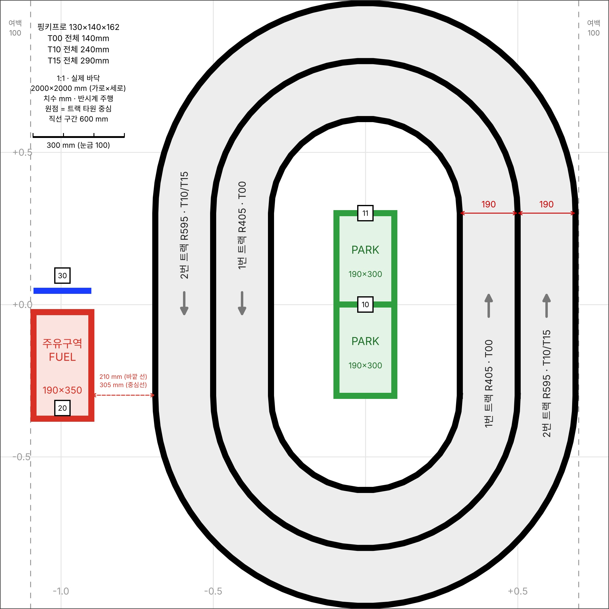

# 02 자율주행 (기획)

마감일: 2026/11/17 오후 2:42 (GMT+9) → 오후 2:42
완료: Yes
상태: 완료

### 주제_자율주행 주유소/주차장 프로젝트

1. 자율주행 로봇(핑키프로 2개_A,B) -- 트레일러길이 A(없음),B(10cm),A(15cm)
A, B 로봇을 전륜구동(FF)트랙터로 정의. 각 로봇의 뒤에 다른 길이의 트레일러를 연결한다.
그러면 동일한 주행로 및 주행학습이라도 로봇이 각기 다른 회전각으로 학습이 필요.
2. 구현 종류
    - 주행_입차
    - 주행_출차
    - 주행_일반: 직진, 차선변경, 앞뒤 간격 조절
    - 카메라_주유소의 바리게이트/라이트 인식
    - 라이다_맵/주변 인식
3. 주행 시연 구역 지도 (사진)
1번 트랙. (안쪽)
2번 트랙. (바깥쪽)
파란 선. 주유소 바리게이트 또는 진입 대기 구역 (3번 트랙 직선구간에 위치)
빨간 박스. 주유소/충전소
초록 박스. 주차장 (크기별)
    1. 지도 
        - ** AI랑 핑크랩사이즈와 프로젝트 시나리오로 테스트해보면서 회전각이랑 레인간격 등 대략 지도 만들어봤습니다.
        
        
        
4. 전체 테스트 시연 순서. 
프로젝트 시연_주차구역에서 시작. A(없음), B(10cm)
1바퀴 돌기_직진 A(없음)1번트랙, B(10cm)2번트랙
1바퀴 돌기_2번트랙 간격조절 직진 A(없음), B(10cm)
차선변경_주유소 순차 들어가기 A(없음), B(10cm)
트레일러 변경_A주유 먼저 끝나면 A(없음 -> 15cm)
주차하기_B(10cm) 주유 후 제자리로 주차
1바퀴 돌기_2번트랙 A(15cm)
주차하기_직선코스 주차장 주차 A(15cm)
프로젝트 시연_주차구역에서 종료 A(15cm), B(10cm)
    1. A(15cm)=T15 의 주행 학습은 여유 있으면 포함.

### 프로젝트 FINAL PLAN

[2] 우선 이번 미니02 — 자율주행 단계에서는 (핑키프로2개)
(1) 핑크로봇 앞뒤길이 ( 기본(14cm)/ 후방 트레일러 10cm(총24cm)) 2가지 학습
(2) 주차장 입차/출차
(3) 도로주행 (직선/곡선/차선변경/앞뒤 간격조절)
까지만 먼저 최소 학습 구현 목표로 잡고 해보면 어떨까 합니다.

[3] 주유소는 미니03 프로젝트 — 모방학습 (OMX 팔 2개) (주유소/충전소) (적재소) 구현 으로 남겨도 좋을 것 같습니다.
(1) 1(주유소/충전소) 2(적재소)  이동
(2) 순차적 출입통제
(3) 충전 모방학습

각 물체에대한 pick & place 모방학습

[4] 미니04  프로젝트는 모두 통합
- 미니01 액션카드(비전인식), 미로찾기(path), OX
- 미니02 자율주행, 트럭 전체 크기별 알고리즘 및 학습 최적화
- 미니03 OMX 팔,
최종 시나리오: 필요시 추가
(1) 음성명령 인식
(2) 비전인식 (차량 고유번호 인식)
(3) 기초 트랙형태 말고 복잡한 지도 (미로 PATH 구하기)
(4) OMX 1(주유소/충전소) 2(적재소) 그대로