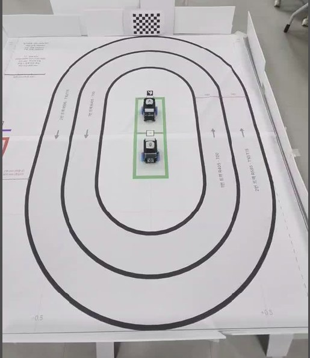
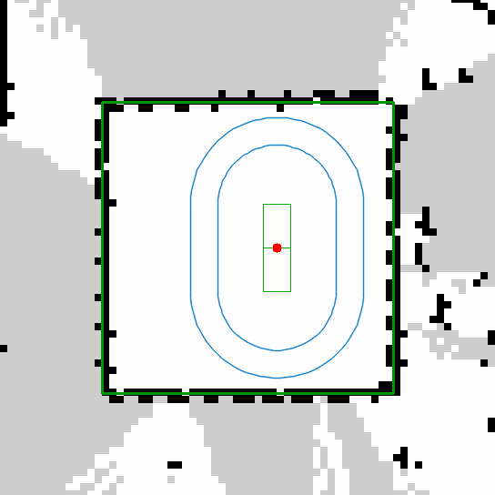
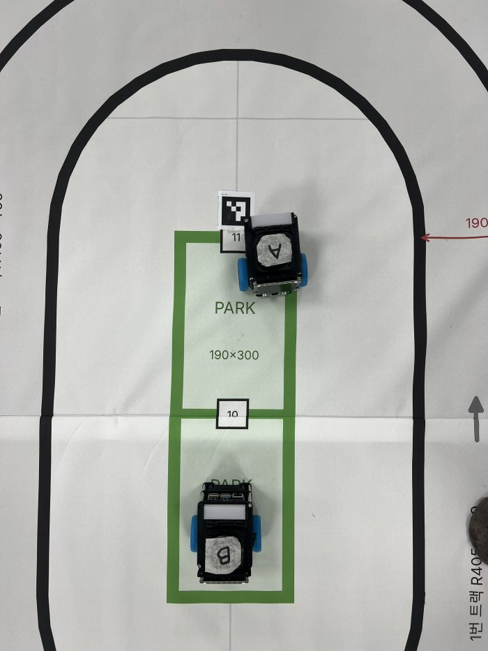
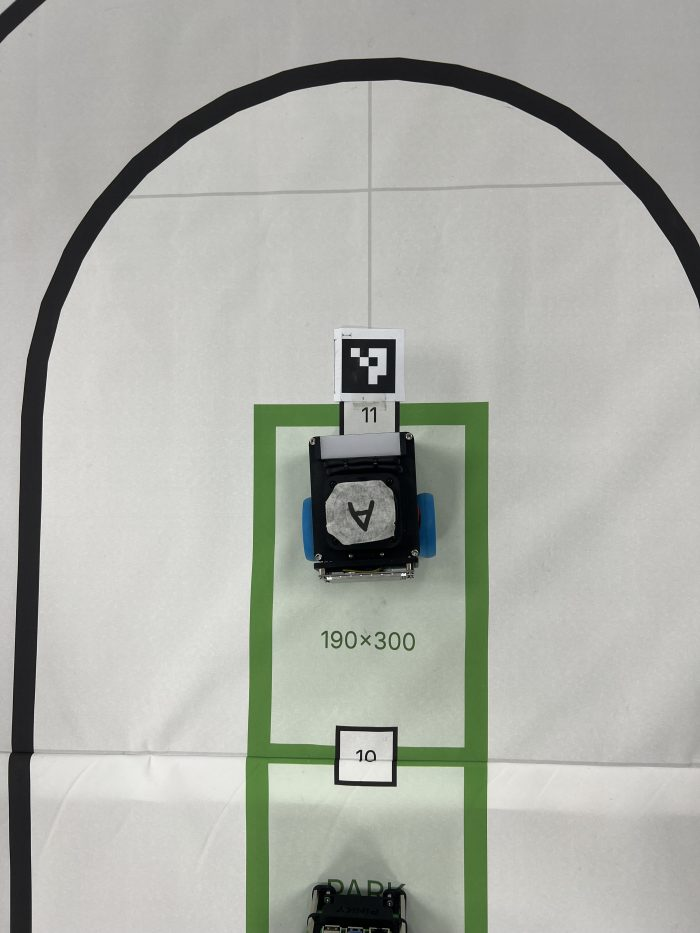
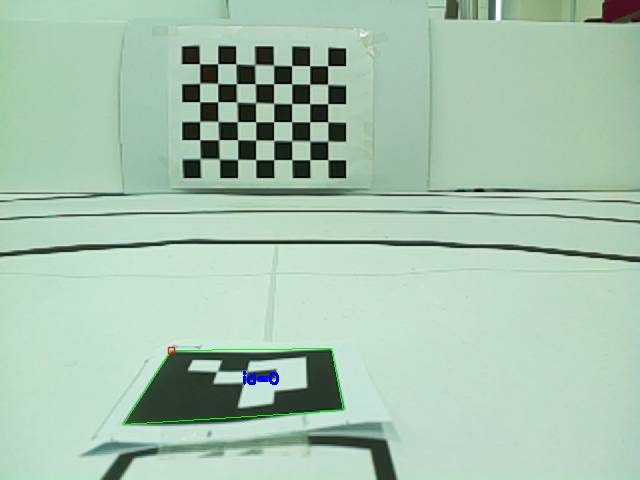

# 파라미터 튜닝 로그

실물 Pinky Pro에서 SLAM과 Nav2 설정을 바꿔 가며 잰 기록입니다. 설정은 한 번에 하나만 바꾸고, 나머지 조건은 같게 둡니다.

값이 비어 있는 칸은 재지 못한 것입니다. 시뮬레이션 값은 비교용으로만 적고 "시뮬레이션"이라고 표시합니다.

## 측정 조건

| 항목 | 값 |
|---|---|
| 날짜, 장소 | 2026-11-28, 강의실 |
| 로봇, 차종 | A = pinky1, B = pinky2. 둘 다 트레일러 없음(`T00`). 시나리오는 B를 `T10`으로 표시하지만 Nav2 footprint는 `T00` |
| 배터리 (시작 → 끝) | A 7.62 → 7.51 V, B 7.60 → 7.45 V (중간에 로봇을 한 번 재시작) |
| 경기장 | 2 × 2 m 판 둘레에 높이 약 20 cm의 벽 네 개. 벽 안쪽 면까지 원점에서 오른쪽 0.78 m, 위쪽 1.01 m(줄자), 왼쪽 1.15 m, 아래쪽 0.97 m(지도) |
| 지도 | 이날 SLAM으로 만든 `room_slam_2`의 원점을 줄자로 바로잡은 것(아래 1절) |
| 위치 추정 | `amcl` (지도 + 라이다). 카메라 마커 보정은 3절에서만 켬 |
| 시작 자리 | A는 11번 칸 가운데에서 위쪽, B는 10번 칸 가운데에서 아래쪽을 봄 |
| 정차 오차를 재는 법 | 위에서 찍은 사진에서 칸 바깥 테두리(190 × 300 mm)를 기준으로 환산. 칸 가운데에서 로봇 바퀴 축 가운데까지 옆·앞뒤 [mm]. 오차 약 ±10 mm, 방향 ±3° |



경기장 판 둘레에 흰 벽을 세운 모습입니다. 가운데 초록 칸에 A(위, 11번 칸)와 B(아래, 10번 칸)가 서 있고, 위쪽 벽의 체스판은 측정에 쓰지 않았습니다.

벽은 라이다(바닥에서 약 12.5 cm)보다 높아야 합니다. 처음 세운 벽은 그보다 낮아 지도에 찍히지 않았고 로봇이 피하지도 못했습니다.

## 기록하는 법

1. 관제 서버는 작업마다 궤적 파일을 `logs/trajectories/`에 남깁니다. 파일에는 그때의 주행 설정, 차종, 실물 여부, 걸린 시간, 경로 오차가 들어 있습니다.
2. 설정은 관제 화면의 **주행 설정**에서 바꿉니다. 바꾼 뒤 같은 코스를 3회 이상 반복합니다.
3. 주차 정차 오차는 측정 도구가 출차와 주차를 반복하고 잰 값을 입력받습니다(명령 전에 Enter로 확인).

   ```bash
   python3 scripts/park_accuracy.py --manual --robot pinky1 --slot slot_11 --runs 3 --csv park_speed015.csv
   ```

4. 측정이 끝나면 궤적 파일을 표로 뽑습니다. 파일 이름의 시각은 컨테이너 시계(UTC)라 한국 시각보다 9시간 이릅니다.

   ```bash
   python3 scripts/trajectory_table.py logs/trajectories --real --since <파일 이름의 시각, 예: 20261128-04> --markdown
   ```

## 1. SLAM

강의실과 경기장 벽으로 지도를 만듭니다. 지도는 로봇 한 대만 켜고 만듭니다(다른 로봇이 벽처럼 남음).

```bash
# 실물 모드 컨테이너 (PINKY_NETWORK=host ./run.sh). 로봇을 11번 칸에 놓고
export ROS_STATIC_PEERS="<A IP>"
ros2 launch pinky_parking_bringup real.launch.py only:=pinky1 localization:=slam max_speed:=0.1
# 새 터미널 (같은 컨테이너): 관제 서버 (전체 정지와 직접 운전)
ros2 launch pinky_parking_control control.launch.py only:=pinky1
# 자동 탐색 (사람이 옆에서 지켜봅니다. 관제 화면의 Esc 로 멈춥니다)
ROS_DOMAIN_ID=11 ros2 run pinky_parking_bringup auto_explore 180 --speed 0.08 --turn 0.5 --radius 2.5
# 지도 저장
ROS_DOMAIN_ID=11 ros2 run pinky_parking_navigation save_slam_map --out <폴더>/room_slam
```

로봇 쪽 준비와 연결 점검은 [real_robot.md](real_robot.md)의 2절과 5절을 따릅니다. 지도 해상도는 공식 값 0.05 m(한 칸 5 cm)입니다. 시작 자리를 로봇 목록(`robots.yaml`)에서 받으므로 지도 좌표가 경기장 도면 좌표와 같습니다.

**지금 설정.** 공식 `mapper_params.yaml`에서 아래만 바꿨습니다(`pinky_parking_navigation/params.py`의 `slam_params`).

| 파라미터 | 공식 | 지금 | 이유 |
|---|---|---|---|
| `minimum_travel_distance` / `heading` | 0.5 m / 0.5 rad | 0.1 m / 0.15 rad | 경기장이 작아 그 사이에 바퀴 기록 오차가 차선 폭만큼 쌓임 |
| `do_loop_closing` | true | false | 좁은 곳을 도는 동안 '같은 곳' 판정이 위치를 튀게 함 |
| `correlation_search_space_dimension` | 0.5 | 0.3 | 한 번에 고치는 폭을 줄임 |
| `coarse_search_angle_offset` | 0.349 | 0.2 | 한 번에 고치는 각을 줄임 |
| `link_match_minimum_response_fine` | 0.1 | 0.2 | 약하게 맞은 결과를 버림 |

**만든 지도.** 모두 위 설정, 자동 탐색 0.08 m/s로 3분입니다.

| 지도 | 조건 | 결과 |
|---|---|---|
| `room_slam_1` | 벽을 세우기 전. 강의실 벽과 가구 | 12.6 × 12.2 m. 아래쪽·오른쪽 벽이 한 줄로 곧게 나옴. 줄자 비교는 하지 못함(벽을 세우며 다시 그림) |
| (저장 안 함) 2회 | 낮은 벽을 세운 뒤 | 벽이 지도에 안 찍히고 로봇이 벽에 부딪혀 중단 |
| `room_slam_2` | 20 cm 벽 네 개 | 벽이 네모로 또렷하게 찍힘. 부딪힘 0번 |

**`room_slam_2`의 치수 비교.**

| 잰 곳 | 줄자 | 지도 | 오차 |
|---|---|---|---|
| 왼쪽 벽 ↔ 오른쪽 벽 (안쪽 면) | 1.93 m | 1.93 m | 0 |
| 원점 → 오른쪽 벽 | 0.78 m | 0.73 m | −5 cm |
| 원점 → 위쪽 벽 | 1.01 m | 0.98 m | −3 cm |

벽 사이 치수는 맞고, 원점이 오른쪽 위로 밀려 있습니다. SLAM을 켤 때 로봇을 손으로 놓은 자리가 곧 좌표 기준이 되기 때문입니다. 지도 파일의 `origin`에 (+0.05, +0.03) m를 더해 바로잡았습니다(`room_slam_2c`). 이 보정의 효과는 2-1절의 주차 오차에서 확인됩니다.

SLAM 설정을 바꿔 지도를 비교하는 일은 하지 못했습니다(설정 한 가지만 측정).



`room_slam_2c`(원점 보정 뒤)에 도면을 겹친 그림입니다. 검은 점이 라이다로 찍힌 벽, 초록 네모가 경기장 판과 주차 칸, 파란 선이 1·2번 트랙의 차선 중심선, 빨간 점이 원점입니다. 2번 트랙의 위·아래가 벽에 가깝습니다(2-4절).

**자동 탐색(`auto_explore`)을 고친 내용.** 처음 것은 실물에서 벽에 부딪혔고 전체 정지로 멈추지 않았습니다.

| 항목 | 전 | 후 |
|---|---|---|
| 앞 확인 | ±30° 각도 안의 가장 가까운 값 | 로봇 폭 + 여유(26 cm) 통로 전체 |
| 속도 | 0.18 m/s 고정 | 인자(실물 0.08). 60 cm부터 줄이고 30 cm에서 돎 |
| 라이다 값이 빈 방향 | 뚫린 것으로 봄 | 앞쪽의 40% 넘게 비면 막힌 것으로 봄(이날 스캔의 26%가 빈 값) |
| 부딪힘 | 모름 | 1.2초 안 움직이면 물러나서 돎 |
| 범위, 정지 | 제한 없음, 프로세스를 죽여야 멈춤 | 출발 자리 기준 반경 제한, 전체 정지로 멈춤 |

## 2. Nav2

**기본값.** 실물은 `real.launch.py`의 인자, 시뮬레이션은 공식 Nav2 설정을 씁니다. 두 값이 다르므로 시뮬레이션 결과를 실물에 그대로 옮기지 않습니다.

| 설정 (관제 화면) | Nav2 파라미터 | 실물 기본 | 시뮬레이션 |
|---|---|---|---|
| 주행 속도 | `FollowPath.desired_linear_vel` | 0.2 m/s | 0.2 m/s |
| 회전 속도 | `FollowPath.rotate_to_heading_angular_vel` | 0.8 rad/s | 1.0 rad/s |
| 곡선 감도 (주시 거리) | `FollowPath.lookahead_dist` | 0.2 m | 0.6 m |
| 도착 허용 거리 | `general_goal_checker.xy_goal_tolerance` | 0.08 m (주차·출차·주유 진입은 관제가 0.03 m, 약 5°로 좁힘) | 같음 |

### 2-1. 주차 정차 오차 (A, 11번 칸, 0.10 m/s)

부호: 옆은 왼쪽 +, 앞뒤는 판 위쪽 +. A는 위쪽으로 출차했다가 칸의 위쪽 끝에서 아래를 보고 들어옵니다.

| 지도 | 회차 | 옆 [mm] | 앞뒤 [mm] | 방향 [°] | 주차 시간 [s] |
|---|---|---|---|---|---|
| 원점 보정 전 (`room_slam_2`) | 1 | −58 | +77 | +4 | 14.5 |
| | 2 | −57 | +82 | 0 | 14.4 |
| | 3 | −56 | +80 | 0 | 14.0 |
| 원점 보정 후 (`room_slam_2c`) | 1 | −7 | +59 | 0 | 15.0 |
| | 2 | −10 | +47 | 0 | 14.2 |
| | 3 | +3 | +46 | 0 | 14.2 |

- 반복 정밀도는 좋습니다. 같은 조건의 세 번이 옆 2~13 mm, 앞뒤 5~13 mm 안에 모입니다.
- 보정 전의 약 10 cm는 지도 원점의 오차였습니다. 원점을 (+5, +3) cm 옮기자 옆 오차가 57 mm에서 5 mm(평균)로 줄었습니다.
- 보정 뒤에도 앞뒤로 평균 51 mm가 남습니다. 로봇이 칸 가운데보다 덜 들어와서 멈춥니다. 허용 오차(30 mm)보다 크므로, 로봇이 믿는 위치가 실제보다 앞서 있는 것으로 봅니다(지도 한 칸이 50 mm).

| 원점 보정 전 (1회차) | 원점 보정 후 (3회차) |
|---|---|
|  |  |

### 2-2. 주행 속도와 걸린 시간

0.10 m/s는 주차 측정, 0.15 m/s는 두 대 시나리오, 0.20 m/s는 2026-11-21 코드로 돌린 1회입니다. 속도별로 같은 횟수를 채우지 못했고, 정차 오차는 0.10 m/s에서만 쟀습니다.

| 속도 | A 출차 [s] | A 1번 트랙 한 바퀴 [s] | 경로 오차 평균 / 최대 [mm] | A 주차 [s] | B 2번 트랙 한 바퀴 [s] |
|---|---|---|---|---|---|
| 0.10 | 13.3, 13.8 | | | 14.0~15.0 (6회, 평균 14.4) | |
| 0.15 | 12.6, 15.3 | 23.9, 24.5, 25.5 | 5~8 / 21~40 | 10.8, 11.6 | 42.5, 43.1 (경로 오차 평균 4) |
| 0.20 | 10.3 | 20.8 | 16 / 92 | | |

- 출차 시간은 위쪽을 보고 시작한 것만 적었습니다. 칸에 거꾸로 선 채 출차하면 180° 도는 시간이 더해져 17.7~19.1초(0.10 m/s)였습니다.
- 0.15에서 0.20으로 올리면 트랙 한 바퀴가 약 4초 줄고, 경로 오차는 평균 2배, 최대 2배 이상으로 커졌습니다(1회 값).
- 경로 오차는 로봇이 믿는 위치 기준입니다.

### 2-3. 진행 감시 (progress checker)

| 설정 | 값 | 결과 |
|---|---|---|
| 공식 | 10초 안에 0.5 m를 못 가면 실패 | 출차 첫 구간이 0.3 m라 조건을 채울 수 없음. 10초 안에 구간을 끝내야만 통과 |
| 고친 값 | 15초 안에 0.15 m | 거꾸로 선 채 출차해 33.5초가 걸려도 성공 |

A의 출차가 한 번 "제자리에서 나아가지 못했습니다"로 실패한 뒤 고쳤습니다. 다만 그 실패에는 위치 추정이 튄 것도 겹쳐 있었습니다([limits.md](limits.md) 1절).

### 2-4. 경로 추종의 충돌 예측 (`FollowPath.use_collision_detection`)

2번 트랙의 차선 중심에서 벽까지가 위쪽 11.5 cm, 아래쪽 7.5 cm입니다. 로봇 footprint(±6 cm)를 빼면 1.5~5.5 cm가 남고, costmap 한 칸이 5 cm입니다.

| 충돌 예측 | B의 2번 트랙 한 바퀴 | 멈춘 자리 |
|---|---|---|
| 켬 (공식) | 4회 중 1회 통과 (42.5초) | 실패 3회 모두 위쪽 곡선 진입부 (0.27~0.30, 0.81~0.82). 그중 1회는 2026-11-21 코드, 0.20 m/s |
| 끔 | 1회 중 1회 통과 (43.1초, 경로 오차 평균 4 mm) | |

- 실패한 3회 중 1회는 위치가 전혀 튀지 않은 주행이었습니다. 벽 간격만으로도 멈춥니다.
- 끄면 경로 앞에 무엇이 있어도 스스로 서지 않습니다. 이날은 사람이 지켜보며 실행 중에만 껐고, 코드의 기본값은 바꾸지 않았습니다.

### 2-5. 재지 못한 것

- 속도 0.15, 0.20 m/s의 주차 정차 오차
- 주시 거리, 도착 허용 거리 비교
- B의 주차 정차 오차(로봇 사이 편차)

## 3. 카메라 마커 위치 보정

A를 11번 칸 가운데에 놓고 칸 위쪽의 바닥 마커(0번, 한 변 5 cm)를 등록한 뒤, 로봇을 들어서 옮겨 놓고 위치가 바로잡히는지 봤습니다.

| 시점 | 로봇이 믿는 위치 (x, y) [m] |
|---|---|
| 옮기기 전 | (0.023, 0.154) |
| 옮긴 뒤, 마커가 화면 밖일 때 | (0.023, 0.154). 옮겨진 것을 모름 |
| 마커가 보인 직후 | (0.040, 0.118). 4.0 cm, 0.9° 고침 |

| 항목 | 실제 (사진) | 믿는 위치 | 차이 |
|---|---|---|---|
| 옆 | 오른쪽 33 mm | 오른쪽 40 mm | 7 mm |
| 앞뒤 | 뒤쪽 16~24 mm | 뒤쪽 32 mm | 8~16 mm |
| 방향 | 약 90° | 94.2° | 약 4° |

시뮬레이션에서는 15 cm를 옮겼을 때 남은 차이가 2 mm였습니다. 마커를 읽을 수 있는 범위와 조건은 [limits.md](limits.md) 1절에 있습니다.



A의 카메라 화면입니다(640 × 480). 아래쪽의 바닥 마커 0번이 검출된 상태이고, 정면 벽의 체스판은 마커가 아닙니다.

## 고른 값과 이유

| 설정 | 고른 값 | 이유 |
|---|---|---|
| SLAM | 지금 설정 + 줄자로 원점 보정 | 벽 사이 치수 오차 0. 원점 오차는 설정이 아니라 놓는 자리에서 나옴 |
| 주행 속도 | 0.15 m/s | 두 대 시나리오가 완주한 속도. 0.20은 경로 오차가 2배 |
| 진행 감시 | 15초 안에 0.15 m | 0.3 m 구간과 180° 회전을 견딤 |
| 충돌 예측 | 벽이 차선에서 12 cm보다 가까우면 끔(사람이 지켜봄), 그 밖에는 켬 | 2-4절 |
| 곡선 감도, 도착 허용 거리 | 실물 기본 그대로 | 비교하지 못함 |
